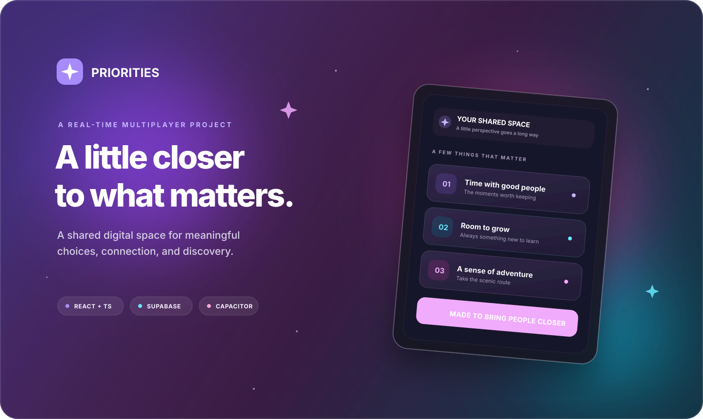

<div align="center">
  
  <h1>Priorities</h1>
  <p><strong>A real-time multiplayer experience about the things that matter.</strong></p>
  <p>A responsive React and TypeScript app, powered by Supabase and ready for the web or Android.</p>
</div>

<p align="center">
  
</p>

<p align="center">
  
  
  
  
  
</p>

## About

Priorities is a source-first project for shared, multiplayer sessions. It brings a live web interface together with account authentication, configurable sessions, synchronized game state, and a mobile-ready layout.

The repository contains the application source, Supabase schema and database routines, and an Android wrapper. It is not a hosted service or a published package.

## Project highlights

- **Live multiplayer state** synchronized through Supabase Realtime.
- **Authenticated accounts** managed with Supabase Auth.
- **Configurable sessions** with adjustable rounds, cards, timers, and reveal preferences.
- **Interactive ranking and reveal interfaces** built for touch and desktop.
- **Four color themes** with saved preferences and animated transitions.
- **Mobile-first experience** with haptic feedback and a Capacitor Android project.

## Technology

| Area | Tools |
| --- | --- |
| UI | React 18, TypeScript 5.9 |
| Build and development | Vite 6 |
| Styling | Tailwind CSS 4 and project CSS |
| Backend | Supabase Auth, PostgreSQL, Realtime |
| Interaction | `@hello-pangea/dnd`, Lucide |
| Mobile | Capacitor 6, Android |

## Repository map

```text
.
├── android/                  # Capacitor Android project
├── docs/assets/              # README artwork
├── public/                   # Static web assets and app manifest
├── src/
│   ├── components/           # Shared UI and session components
│   ├── hooks/                # State synchronization and app hooks
│   ├── lib/                  # Supabase client
│   ├── screens/              # Authentication and session screens
│   ├── types/                # Shared application and database types
│   └── utils/                # Focused helpers
└── supabase/                 # Database schema and card seed SQL
```

## Get started

### Requirements

- Node.js 18 or newer and npm.
- A Supabase project with Auth and Realtime available.
- Android Studio and the Android SDK for native Android development.

### Install dependencies

```bash
npm install
```

### Configure Supabase

Create a local environment file from the example:

```bash
cp .env.example .env.local
```

On Windows PowerShell:

```powershell
Copy-Item .env.example .env.local
```

Set `VITE_SUPABASE_URL` to your Supabase project URL and `VITE_SUPABASE_ANON_KEY` to that project's publishable/anon key in `.env.local`. The URL in the example is only a default; use the URL for your own project.

In your Supabase project's SQL Editor, run [`supabase/01_schema.sql`](./supabase/01_schema.sql) to create or update the application schema. Create the accounts used by your installation through Supabase Auth; the app provides sign-in, not public account registration.

> **Database warning:** [`supabase/02_reset_and_seed_cards.sql`](./supabase/02_reset_and_seed_cards.sql) replaces the card deck and deletes round progress. It also resets unfinished sessions to the lobby. Review the script and its effects before running it.

### Start the web app

```bash
npm run dev
```

Vite prints the local development URL in the terminal.

### Build and preview

```bash
npm run build
npm run preview
```

The production web build is written to `dist/`.

### Android

After configuring Supabase and installing dependencies:

```bash
npm run build
npx cap sync android
npx cap open android
```

Build and run the Android app from Android Studio.

## Configuration and deployment notes

- Keep `.env.local` private. It is ignored by Git; never put a Supabase service-role key in a client-side environment variable.
- The SQL schema defines Row Level Security policies for application access. Review and adapt them for your threat model before exposing a deployment to the public.
- `02_reset_and_seed_cards.sql` is a development/setup utility, not a routine deployment migration.
- Runtime credentials and production infrastructure are managed separately from this source tree.

## License

No license is currently specified. All rights remain with their respective owners.
